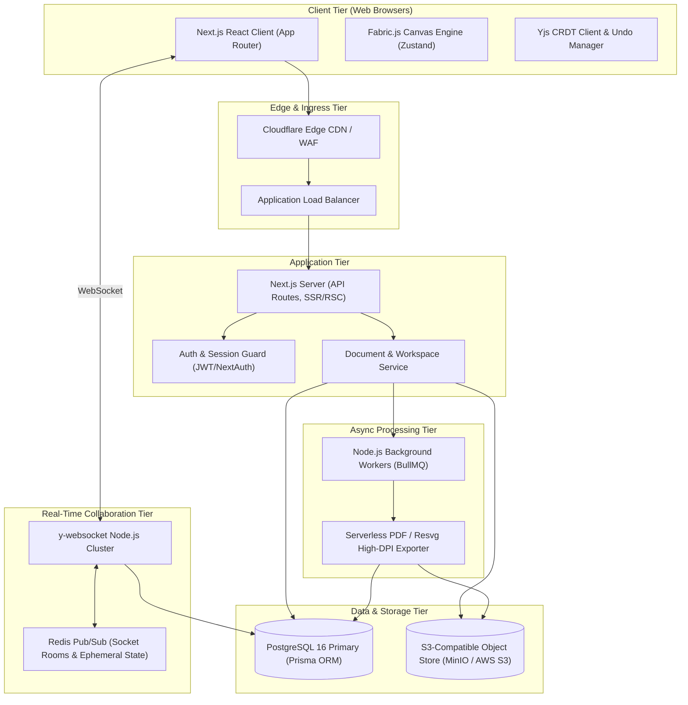
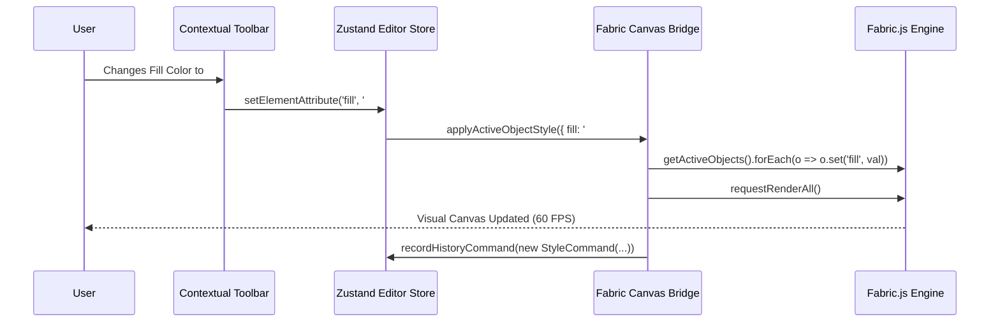
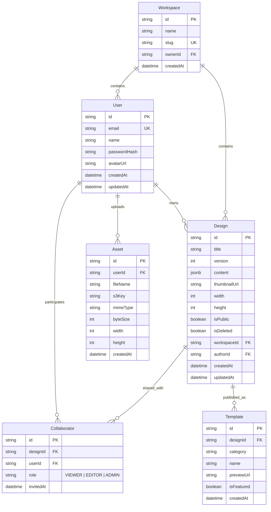
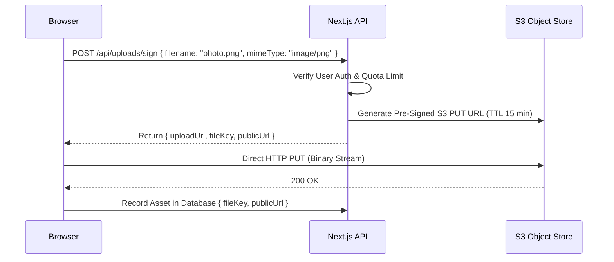
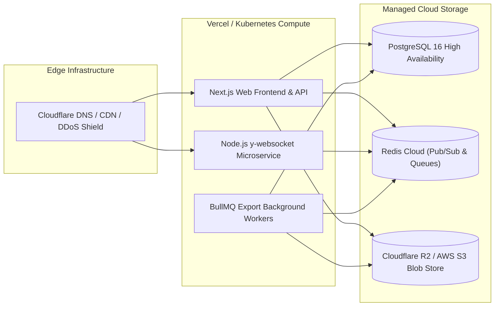

# DesignFlow - Technical Architecture Document

> **Document Version:** 1.0.0  
> **Target Audience:** Principal Architects, Full-Stack Engineers, DevOps  
> **Status:** Architecture Baseline

---

## 1. System Overview

DesignFlow is structured as a cloud-native, real-time visual design application with a modern Next.js client-server boundary, an interactive HTML5 2D Canvas rendering engine, a decoupled asynchronous export worker cluster, and a real-time CRDT synchronization tier.

### High-Level Architecture Diagram



---

## 2. Technology Stack & Decision Rationale

| Category | Technology | Rationale & Alternatives Considered |
| :--- | :--- | :--- |
| **Frontend Framework** | **Next.js 14+ (App Router)** | Provides hybrid Server-Side Rendering (SSR) for blazing-fast dashboard discovery, Server Actions for streamlined mutations, and client-side isolation for the high-frequency canvas environment. *Alternative considered: Vite SPA (lacks native SEO/SSR for public shared templates).* |
| **Client State Management** | **Zustand** | Minimalist boilerplate, unopinionated reactive store, zero-overhead selector subscriptions outside React render loops (crucial for 60 FPS canvas events). *Alternative considered: Redux Toolkit (too verbose), Jotai (excessive re-render overhead for canvas frame loops).* |
| **Styling & UI Kit** | **Tailwind CSS + Radix UI (shadcn/ui)** | Unstyled, accessible primitives with utility classes enable rapid prototyping of Canva-grade dock panels and sliders without bundle bloat. |
| **Canvas Engine** | **Fabric.js v6 (TypeScript)** | Mature object-oriented abstraction on HTML5 Canvas. Native support for complex transforms, multi-selection, SVG import/export, and extensible interactive textboxes (`fabric.Textbox`). *Alternative considered: Konva.js (weaker rich-text editing), PixiJS (overkill WebGL shader focus).* |
| **Real-Time Collaboration** | **Yjs + y-websocket** | Conflict-free Replicated Data Type (CRDT) engine with provable state convergence, low network bandwidth overhead, and built-in undo/redo managers. *Alternative considered: Automerge (higher memory footprint), Operational Transformation (requires centralized lockstep server).* |
| **Backend & API** | **Next.js Route Handlers + Node.js** | Unified TypeScript codebase, type sharing across client and server with Zod schema validation. |
| **Database & ORM** | **PostgreSQL 16 + Prisma ORM** | ACID-compliant relational data modeling for workspaces, access control, and design metadata. Robust `JSONB` support allows flexible page serialization. |
| **File / Asset Storage** | **S3-Compatible Object Store** | Scalable, standard blob storage for user image uploads, rendered thumbnails, and PDF outputs. S3 Pre-signed PUT/GET URLs avoid passing binary blobs through the web server. |
| **Task Queue** | **BullMQ + Redis** | Reliable Redis-backed message queue for heavy asynchronous tasks (high-res multi-page PDF generation, template asset bundling). |

---

## 3. Frontend Architecture

### 3.1 Directory Structure (Next.js App Router)

```
src/
├── app/
│   ├── (auth)/
│   │   ├── login/page.tsx
│   │   └── register/page.tsx
│   ├── (dashboard)/
│   │   ├── layout.tsx
│   │   ├── page.tsx                     # User designs dashboard
│   │   ├── templates/page.tsx           # Template gallery
│   │   └── trash/page.tsx
│   ├── editor/
│   │   └── [designId]/
│   │       ├── page.tsx                 # Editor view shell
│   │       └── loading.tsx
│   └── api/
│       ├── auth/[...nextauth]/route.ts
│       ├── designs/route.ts
│       ├── designs/[id]/route.ts
│       ├── export/route.ts
│       └── uploads/route.ts
├── components/
│   ├── ui/                              # Radix/shadcn primitives
│   ├── dashboard/                       # Project grids, cards, modals
│   └── editor/
│       ├── canvas/                      # Canvas wrapper, rulers, guides
│       ├── header/                      # Top bar, autosave badge, export modal
│       ├── toolbars/                    # Dynamic contextual toolbars
│       └── panels/                      # Left drawers (Elements, Text, etc.)
├── stores/
│   ├── use-editor-store.ts              # Core Zustand editor state
│   ├── use-canvas-history-store.ts      # Command history & undo/redo
│   └── use-collab-store.ts              # Real-time awareness & cursors
├── lib/
│   ├── canvas/                          # Fabric.js helpers, wrappers, extensions
│   ├── export/                          # Rasterization, PDF generation
│   ├── prisma.ts                        # Database client singleton
│   └── s3.ts                            # S3 pre-signed URL utilities
└── types/
    └── document.ts                      # DesignFlow document JSON schema
```

### 3.2 State Management Boundary
- **Server State**: Managed via React Server Components and SWR/TanStack Query for dashboard listings, user profiles, and permission queries.
- **Editor Transient State (Zustand)**: Active tool (Select, Pan, Text, Shape), zoom level, selection ID set, snapping guidelines, sidebar drawer active tab.
- **Canvas Object State**: Managed directly inside Fabric.js canvas instances. React components subscribe to Zustand selectors without triggering unneeded re-renders on every mouse drag event.

---

## 4. Editor Engine Architecture

### 4.1 Fabric.js Integration Lifecycle
Fabric.js binds directly to a `<canvas>` element via a React `useRef`. React never directly updates canvas child nodes via JSX; instead, an imperative bridge pattern translates Zustand actions into Fabric API calls.



### 4.2 Command Pattern & Undo/Redo Engine
All destructive or mutable canvas actions implement the `Command` interface:

```typescript
export interface EditorCommand {
  id: string;
  timestamp: number;
  description: string;
  execute(canvas: fabric.Canvas): void;
  undo(canvas: fabric.Canvas): void;
}
```

- **`AddObjectCommand`**: Adds an object; undo removes the object.
- **`RemoveObjectCommand`**: Deletes an object; undo re-inserts the serialized object at original index.
- **`TransformCommand`**: Records before-state and after-state bounding coordinates (`left`, `top`, `scaleX`, `scaleY`, `angle`).
- **`StyleCommand`**: Records before-state and after-state element properties (fill, stroke, opacity, font).
- **History Limits**: Stack size capped at 100 commands to ensure strict memory ceiling.

---

## 5. Document Model Design

The design document schema is stored in PostgreSQL as a validated JSON document adhering to the following TypeScript definition:

```typescript
export interface DesignDocument {
  version: "1.0.0";
  id: string;
  title: string;
  unit: "px" | "in" | "mm";
  dimensions: {
    width: number;
    height: number;
  };
  globalStyles: {
    backgroundColor: string;
  };
  pages: DesignPage[];
  metadata: {
    createdAt: string;
    updatedAt: string;
    authorId: string;
  };
}

export interface DesignPage {
  id: string;
  name: string;
  order: number;
  backgroundColor: string;
  objects: CanvasObjectNode[];
}

export type CanvasObjectNode = 
  | TextObjectNode 
  | ShapeObjectNode 
  | ImageObjectNode 
  | GroupObjectNode;

export interface BaseObjectNode {
  id: string;
  type: "textbox" | "rect" | "circle" | "triangle" | "image" | "group";
  left: number;
  top: number;
  width: number;
  height: number;
  scaleX: number;
  scaleY: number;
  angle: number;
  opacity: number;
  locked: boolean;
  visible: boolean;
  shadow?: {
    color: string;
    blur: number;
    offsetX: number;
    offsetY: number;
  };
}

export interface TextObjectNode extends BaseObjectNode {
  type: "textbox";
  text: string;
  fontFamily: string;
  fontSize: number;
  fontWeight: string | number;
  fontStyle: "normal" | "italic";
  underline: boolean;
  textAlign: "left" | "center" | "right" | "justify";
  fill: string;
  lineHeight: number;
  charSpacing: number;
}

export interface ShapeObjectNode extends BaseObjectNode {
  type: "rect" | "circle" | "triangle";
  fill: string;
  stroke: string;
  strokeWidth: number;
  strokeDashArray?: number[];
  rx?: number; // Corner radius for rects
  ry?: number;
}

export interface ImageObjectNode extends BaseObjectNode {
  type: "image";
  src: string;
  originalWidth: number;
  originalHeight: number;
  crop?: {
    x: number;
    y: number;
    width: number;
    height: number;
  };
  filters?: {
    brightness?: number;
    contrast?: number;
    blur?: number;
  };
}

export interface GroupObjectNode extends BaseObjectNode {
  type: "group";
  objects: CanvasObjectNode[];
}
```

---

## 6. Backend Architecture

### 6.1 API Routes Specification
- `POST /api/auth/register` - Create user account
- `GET /api/designs` - List user designs (supports pagination, search, sort)
- `POST /api/designs` - Initialize new design record
- `GET /api/designs/:id` - Fetch document JSON and verify permissions
- `PUT /api/designs/:id` - Autosave/update document JSON payload
- `DELETE /api/designs/:id` - Soft delete design to trash
- `POST /api/uploads/sign` - Generate pre-signed S3 upload URL
- `POST /api/export` - Enqueue server-side multi-page export job

### 6.2 Autosave Strategy & Concurrency Guard
1. **Debounce Trigger**: Any canvas change fires a 1500ms debounced persistence routine.
2. **Optimistic Dirty Check**: If document serialization checksum matches server state, skip network trip.
3. **Optimistic Locking**: Designs contain an incrementing integer `version`. The update query executes:
   ```sql
   UPDATE "Design"
   SET "content" = $1, "version" = "version" + 1, "updatedAt" = NOW()
   WHERE "id" = $2 AND "version" = $3;
   ```
   If 0 rows are affected due to a conflict, the client performs conflict reconciliation.

---

## 7. Database Design (PostgreSQL + Prisma)

### Entity-Relationship Diagram



---

## 8. File Storage Strategy (S3-Compatible)

To ensure zero server memory bottlenecks, file uploads bypass the application server entirely:



- **Asset Lifecycle**: Images are stored under `uploads/{userId}/{assetId}.[ext]`.
- **Thumbnails**: Canvas generates a low-resolution base64 dataURL on autosave, which is written to S3 as `thumbnails/{designId}.webp` for instantaneous dashboard loading.

---

## 9. Real-Time Collaboration Approach (Yjs)

When multiple users collaborate on a design:

1. **CRDT Data Structure**: The `DesignDocument` is mapped to a `Y.Doc`.
   - Each page is represented as a `Y.Array<Y.Map<any>>` containing element properties.
2. **Transport**: `y-websocket` connects the browser to an ephemeral Node.js WebSocket gateway.
3. **Awareness Protocol**:
   - Transmits active user cursor coordinates `(x, y)` relative to the canvas coordinate plane.
   - Transmits currently selected object IDs to render colored selection halos around items locked by peers.
4. **Persistence Bridge**: The WebSocket gateway flushes debounced state snapshots into PostgreSQL.

---

## 10. Security Architecture

- **Authentication & Sessions**: HTTP-only, SameSite=Strict cookies protect against CSRF attacks.
- **Object Storage Access**: Public access is disallowed on the S3 bucket; read access for user-uploaded assets is facilitated via signed URLs or a cached Cloudflare CDN worker checking auth headers.
- **SVG Sanitization**: Any uploaded SVG vector is purified using `DOMPurify` with strict XML attribute allowlists before injection into the Fabric canvas to eliminate inline script execution.
- **SQL Injection Defense**: All database transactions are parameterized via Prisma ORM queries.

---

## 11. Deployment Architecture


