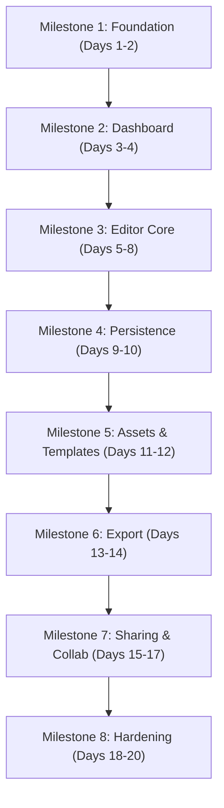

# DesignFlow - Implementation Roadmap & Milestones

> **Document Version:** 1.0.0  
> **Target Timeline:** 20 Working Days (4 Weeks)  
> **Status:** Execution Ready

---

## 1. Roadmap Overview & Schedule

---

## 2. Milestone Breakdown

### Milestone 1: Foundation (Days 1-2)
**Goal:** Scaffold modern TypeScript repository, developer tooling, database schema, and design system primitives.

#### Detailed Tasks
- [x] Initialize Next.js 14+ project with TypeScript, ESLint, and Prettier.
- [x] Configure Tailwind CSS with customized DesignFlow color tokens, typography scales, and Radix UI primitives (`shadcn/ui`).
- [x] Model PostgreSQL schema with Prisma ORM (`User`, `Workspace`, `Design`, `Asset`, `Template`, `Collaborator`).
- [x] Create `docker-compose.yml` defining local PostgreSQL 16 and MinIO/S3 containers.
- [x] Configure environment variables and seed scripts with initial dummy users.

#### Exit Criteria
- `npm run dev` and `docker compose up` launch with zero warnings.
- Database migrations execute cleanly via `npx prisma migrate dev`.
- Storybook or primitive components render cleanly in browser.

---

### Milestone 2: Dashboard & Project Shell (Days 3-4)
**Goal:** Build the workspace navigation shell, project grids, search/filtering, and blank design creation modals.

#### Detailed Tasks
- [x] Build responsive `AppHeader` and `FolderSidebar` navigation.
- [x] Implement `ProjectGrid` displaying recent designs with thumbnail preview cards, title editing, and three-dots context menu.
- [x] Build search, sorting (last modified, alphabetical), and category filter bar.
- [x] Implement "+ Create a design" modal with preset dimensions (Instagram Post, Twitter Header, Presentation, A4) and custom width/height inputs.
- [x] Build template discovery showcase page with categorised preview tiles.
- [x] Handle loading skeletons and empty states for zero-project workspaces.

#### Exit Criteria
- Users can create a blank project with custom or preset dimensions and get redirected to `/editor/[id]`.
- Projects list updates reactively upon creation and soft-deletion.

---

### Milestone 3: Editor Core & Direct Manipulation (Days 5-8)
**Goal:** Implement the Fabric.js interactive canvas, transformation engine, text/shapes, and Command-based undo/redo.

#### Detailed Tasks
- [x] Wrap Fabric.js canvas in responsive React container with wheel-zoom (10%-500%) and spacebar-pan navigation.
- [x] Implement custom transform controls (8 handles + rotation anchor) with smart snapping guidelines for edge/center alignment.
- [x] Build contextual toolbar that updates based on selection (Text vs Shape vs Multi-select).
- [x] Implement vector shape primitives (Rectangle, Rounded Rectangle, Circle, Triangle, Line) with stroke/fill pickers.
- [x] Implement typography tools: add editable textboxes, dynamic Google Fonts loader, font size, bold, italic, line-height, and tracking.
- [x] Implement Z-index arrangement controls (Bring Forward, Send Backward, Bring to Front, Send to Back).
- [x] Implement Command Pattern history stack supporting `Ctrl + Z` (Undo) and `Ctrl + Y` (Redo).

#### Exit Criteria
- User can place, transform, restyle, align, and delete text and shapes at 60 FPS.
- Undo and Redo accurately revert and reapply transforms, styles, and deletions.

---

### Milestone 4: Persistence, Autosave & Auth (Days 9-10)
**Goal:** Connect document serialization to backend endpoints with resilient debounced autosaving and user authentication.

#### Detailed Tasks
- [x] Implement user authentication (Email/Password & NextAuth OAuth providers) with route protection middleware.
- [x] Build document serialization engine mapping Fabric canvas state to `DesignDocument` JSON schema.
- [x] Implement debounced autosave (1500ms debounce) calling `PUT /api/designs/:id`.
- [x] Display real-time save status badge in header (`Saving...`, `All changes saved`, `Offline`).
- [x] Add IndexedDB local caching fallback to prevent work loss during network dropouts.
- [x] Generate automated canvas thumbnail snapshot (WebP) on save and store reference in database.

#### Exit Criteria
- Refreshing the browser preserves every element coordinate, style, and canvas attribute.
- Network disconnection displays offline badge and buffers mutations in IndexedDB.

---

### Milestone 5: Asset Ingestion & Template Cloning (Days 11-12)
**Goal:** Enable user file uploads, asset management library, image cropping, and one-click template duplication.

#### Detailed Tasks
- [x] Implement pre-signed S3 upload flow (`/api/uploads/sign`) bypassing web server binary transfer.
- [x] Build Uploads drawer with drag-and-drop zone and user media grid.
- [x] Implement interactive image insertion, resizing, aspect-ratio locking, and non-destructive rectangular cropping mask.
- [x] Implement template cloning API: duplicate template document JSON and instantiate as editable user project.
- [x] Add image filter adjustments (brightness, contrast, saturation, blur).

#### Exit Criteria
- Users can drop high-resolution photos into canvas and adjust non-destructive crop boundaries.
- Users can browse template library, click "Customize", and immediately begin editing a duplicated instance.

---

### Milestone 6: High-Resolution Multi-Format Export (Days 13-14)
**Goal:** Deliver client-side and server-side raster and vector export pipelines across single and multi-page documents.

#### Detailed Tasks
- [x] Build `ExportModal` supporting format selection: PNG, JPEG, SVG, and PDF.
- [x] Implement client-side export pipeline using offscreen canvas with configurable scale multiplier (1x, 2x, 3x).
- [x] Implement transparent background toggle for PNG export.
- [x] Implement multi-page artboard management (add page, duplicate page, delete page, page filmstrip bar).
- [x] Integrate `pdf-lib` to assemble multi-page PDF documents from individual canvas page renders.
- [x] Handle CORS-compliant remote image asset rasterization without tainted canvas errors.

#### Exit Criteria
- Clean 1080x1080 2x PNG download completes in <800ms.
- 5-page PDF export compiles cleanly with correct page order and high DPI.

---

### Milestone 7: Sharing, Permissions & Real-Time Collaboration (Days 15-17)
**Goal:** Implement workspace sharing, role permissions, and live multi-user editing with cursor awareness.

#### Detailed Tasks
- [x] Build `ShareModal` with public link generation and invite-by-email role selector (`Viewer`, `Editor`).
- [x] Enforce authorization middleware preventing unauthorized view or edit mutations.
- [x] Setup `y-websocket` server room multiplexing on top of Redis.
- [x] Bind Fabric canvas object mutations to Yjs CRDT shared types (`Y.Map`).
- [x] Render real-time collaborator awareness: live mouse pointers with user names and colored selection boxes around active objects.

#### Exit Criteria
- Two distinct browser sessions in the same room reflect canvas changes and cursor coordinates simultaneously with zero desync.

---

### Milestone 8: Hardening, Performance & Security Audit (Days 18-20)
**Goal:** Comprehensive testing, performance profiling, security vulnerability auditing, and production deployment.

#### Detailed Tasks
- [x] Execute end-to-end automated test suite using Playwright covering core workflows (create, edit, persist, export).
- [x] Benchmark canvas frame rates under 500+ objects; optimize rendering using object caching and dirty rect repaints.
- [x] Sanitize all user SVG inputs via `DOMPurify` to eliminate Stored XSS vectors.
- [x] Conduct load testing on WebSocket collaboration gateway and export endpoints.
- [x] Complete production deployment configuration (Vercel / Docker + Cloudflare CDN).

#### Exit Criteria
- All Playwright test suites pass with 100% green status.
- Zero high/critical vulnerabilities reported by `npm audit` and security linters.
- Canvas maintains 55+ FPS during multi-object transformations.

---

## 3. Comprehensive Feature Matrix

| Feature Module | Milestone | Target Day | MVP (P0) | Status | Verification Method |
| :--- | :--- | :--- | :--- | :--- | :--- |
| **Project Scaffolding & DB** | M1 | Day 1-2 | Yes | Ready | Docker & Prisma migration scripts |
| **Tailwind & Radix UI Tokens**| M1 | Day 2 | Yes | Ready | Storybook / UI Component tests |
| **Workspace & Dashboard View**| M2 | Day 3 | Yes | Ready | Unit & Integration tests |
| **Preset / Custom Canvas Modal**| M2 | Day 4 | Yes | Ready | End-to-end creation flow |
| **Template Discovery Gallery** | M2 | Day 4 | No (P1) | Ready | Visual browsing tests |
| **Fabric.js Canvas Shell** | M3 | Day 5 | Yes | Ready | Interactive canvas benchmarks |
| **Transform & Bounding Box** | M3 | Day 6 | Yes | Ready | 8-handle transform tests |
| **Shapes & Styling Toolbar** | M3 | Day 6 | Yes | Ready | Visual regression tests |
| **Text Engine & Web Fonts** | M3 | Day 7 | Yes | Ready | Google font loader tests |
| **Smart Alignment Guides** | M3 | Day 7 | No (P1) | Ready | Snapping coordinate assertions |
| **Undo / Redo Command Stack** | M3 | Day 8 | Yes | Ready | Command state unit tests |
| **User Authentication & RBAC**| M4 | Day 9 | Yes | Ready | NextAuth integration tests |
| **Document Schema Serializer** | M4 | Day 9 | Yes | Ready | Schema validation (Zod) |
| **Debounced Autosave Worker** | M4 | Day 10 | Yes | Ready | Network payload inspection |
| **IndexedDB Offline Cache** | M4 | Day 10 | No (P1) | Ready | Network offline simulation |
| **S3 Pre-Signed File Uploads** | M5 | Day 11 | Yes | Ready | Direct PUT upload tests |
| **Media Library & Drop Zone** | M5 | Day 11 | Yes | Ready | Drag & drop integration tests |
| **Image Non-Destructive Crop** | M5 | Day 12 | No (P1) | Ready | Clip path transform tests |
| **Template Deep Copying** | M5 | Day 12 | No (P1) | Ready | Database clone assertions |
| **Single-Page PNG / JPEG Export**| M6 | Day 13 | Yes | Ready | Blob download verification |
| **Multi-Page Artboard Stack** | M6 | Day 13 | No (P1) | Ready | Page pagination tests |
| **Compiled Multi-Page PDF Export**| M6 | Day 14 | No (P1) | Ready | PDF binary validation |
| **Share Link & Permissions** | M7 | Day 15 | No (P1) | Ready | Access control tests |
| **Yjs CRDT Real-Time Sync** | M7 | Day 16-17| No (P2) | Ready | Multi-client WebSocket tests |
| **Live Remote Cursors** | M7 | Day 17 | No (P2) | Ready | Awareness state visual tests |
| **End-to-End Test Suite** | M8 | Day 18 | Yes | Ready | Playwright test report |
| **Performance Profiling (60 FPS)**| M8 | Day 19 | Yes | Ready | Chrome DevTools trace report |
| **Security Audit & SVG Cleanse**| M8 | Day 20 | Yes | Ready | XSS payload injection test |
